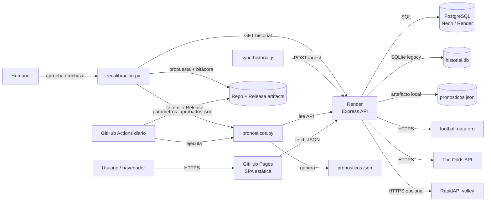
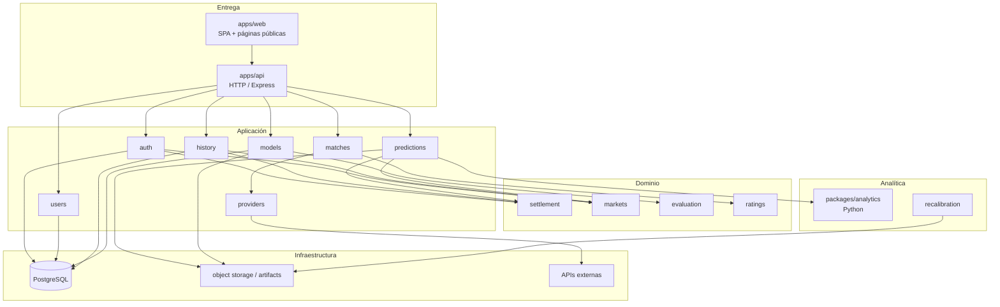
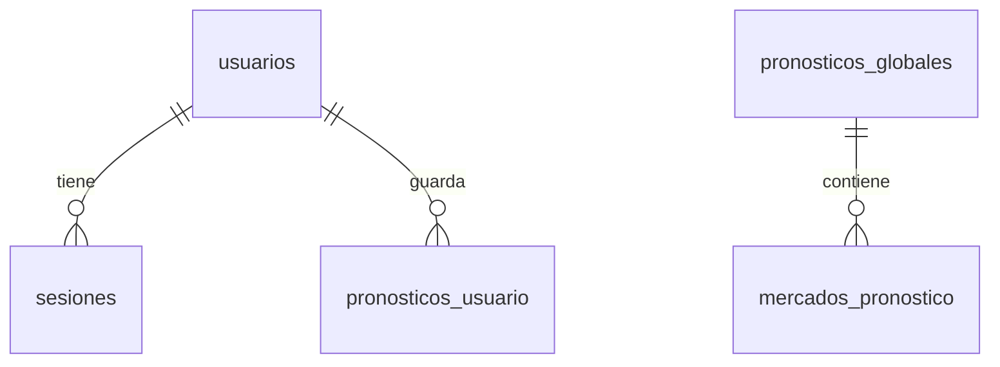

# Arquitectura de Fulbito

> **Estado:** documento normativo de la fase 1 (auditoría y diseño).
> **Alcance:** describe el sistema **tal como está** y la arquitectura **objetivo**.
> No autoriza por sí mismo cambios de código, endpoints ni base de datos.
> **Fecha:** 2026-11-20
> **Decisiones relacionadas:** [ADR-001](./ADR-001-modular-monolith.md)

---

## 1. Propósito

Fulbito es una plataforma de pronósticos deportivos con tres capacidades:

1. **Generar** pronósticos estadísticos explicables para partidos de fútbol (y, de forma experimental, otros deportes).
2. **Registrar** un historial público verificable de esos pronósticos y liquidarlos contra resultados reales.
3. **Evaluar y recalibrar** el motor con métricas probabilísticas, backtesting temporal y aprobación humana.

Este documento fija los límites de los módulos, las reglas de dependencia y el camino de migración. El principio rector es **monolito modular con migración incremental**: un solo despliegue, límites internos explícitos y ningún reemplazo del motor estadístico sin evidencia de equivalencia o mejora.

---

## 2. Estado actual (as-is)

### 2.1 Componentes en producción



### 2.2 Inventario real

| Componente | Ubicación | Tamaño | Rol actual |
|---|---|---:|---|
| SPA | `index.html`, `style.css`, `app-*.js`, `events.js`, `auth.js`, `bootstrap.js` | ~21k líneas | Toda la interfaz, estado y una implementación JS del motor |
| API | `server/server.js` | 1.926 líneas | Rutas, auth, proveedores, historial, liquidación, deportes |
| Persistencia | `server/db.js` | 151 líneas | Pool PostgreSQL y migraciones |
| Seguridad | `server/seguridad.js` | 153 líneas | scrypt, limitadores, comparación segura |
| Liquidación | `server/liquidacion.js` | 147 líneas | Reglas puras de acierto/fallo |
| Motor canónico | `pronosticos.py` | 2.009 líneas | Poisson + Dixon-Coles, híbrido ML, EV/Kelly |
| Evaluación | `recalibracion.py` | 1.457 líneas | Brier, calibración, backtesting, Platt, propuestas |
| Motores multi-deporte | `backend_motores/*.py`, `motor_*.py` | variable | Elo básquet/tenis/vóley, con duplicación |
| Landing | `web/` (Astro) | separado | Fase 0 de migración de páginas públicas |

### 2.3 Lo que ya funciona y debe preservarse

- El **contrato HTTP actual** (24 rutas) y los artefactos que consume el frontend.
- El **motor de fútbol** `pronosticos.py` y sus gates de recalibración.
- La **liquidación server-side** (`liquidacion.js`) y el historial global idempotente.
- La **suite de pruebas existente** (ver `TESTING.md`), incluyendo paridad Python↔JS.

### 2.4 Deuda estructural confirmada

| # | Hallazgo | Evidencia | Impacto |
|---|---|---|---|
| D1 | `server.js` concentra múltiples responsabilidades | 1.926 líneas, 24 rutas | Baja testabilidad, alto riesgo de regresión |
| D2 | `app-model.js` mezcla config, red, estado, UI y motor | 2.177 líneas, scope global | Imposible razonar sobre límites; colisiones globales |
| D3 | Liquidación inicialmente duplicada | Python, `app-model.js`, `liquidacion.js` | **P0 resuelta en Fase 1**; servidor usa `packages/domain/settlement/index.js` en Fase 3 |
| D4 | Pool único PostgreSQL | `db.js` pool y `cargarStorageHistorial()` | Migraciones idempotentes; SQLite solo test/local; pruebas de restauración en Fase 3 |
| D5 | Persistencia híbrida | kv + Postgres + SQLite + JSON + JSONL | Fuente de verdad ambigua |
| D6 | Tenis duplicado y divergente | `motor_tenis.py` vs `backend_motores/motor_tenis.py` | Resultados distintos según entrypoint |
| D7 | Básquet Elo duplicado | Python vs JS en `server.js` | Paridad no verificada |
| D8 | Vóley backend es placeholder | `backend_motores/motor_voley.py` | Endpoint puede devolver datos no reales |
| D9 | Versionado Express inconsistente | raíz `^5.2.1`, `server/` `^4.18.2` | Instalaciones no reproducibles |
| D10 | Artefactos de datos versionados en Git | `pronosticos_historicos.jsonl` 662 KB | Crecimiento sin límite, sin consultas |

---

## 3. Principios de arquitectura

1. **Una sola fuente de verdad por regla de negocio.** Toda regla de liquidación, probabilidad o evaluación vive en un único módulo y se consume desde los demás.
2. **Dominio puro, infraestructura reemplazable.** Las reglas no importan Express, `pg`, `better-sqlite3`, DOM ni `fetch`.
3. **Dependencias hacia adentro.** HTTP → aplicación → dominio. Nunca al revés.
4. **Contratos explícitos.** Los endpoints y artefactos se describen con esquemas versionados.
5. **Compatibilidad primero.** Ningún cambio de endpoint, esquema o fórmula sin análisis de consecuencias y período de convivencia.
6. **Migración strangler.** Se extraen módulos detrás de seams; no se reescribe la aplicación.
7. **Evidencia antes que intuición.** Un cambio de modelo requiere backtesting temporal y out-of-sample; una recalibración requiere aprobación humana.
8. **Seguridad y observabilidad por diseño.** Toda ruta nueva nace con validación, límites, logs y métricas.
9. **Testabilidad.** Cada regla pura debe poder probarse sin red ni base de datos.
10. **Sin dependencias nuevas injustificadas.** Primero la biblioteca estándar y lo ya instalado.

---

## 4. Arquitectura objetivo (to-be)

### 4.1 Forma general

**Monolito modular**: un proceso API desplegable, una SPA, un pipeline analítico. Los módulos se comunican por interfaces en proceso, no por red. La extracción a servicios queda como opción futura, no como objetivo.



### 4.2 Capas y reglas de dependencia

| Capa | Puede depender de | Prohibido |
|---|---|---|
| `apps/web` | contratos HTTP, dominio puro replicado solo si hay paridad obligatoria | acceso directo a DB o proveedores |
| `apps/api` | aplicación, dominio, puertos | lógica estadística duplicada |
| aplicación | dominio, puertos | detalles de Express, SQL, DOM |
| dominio | nada (solo tipos y matemática) | I/O, red, DB, frameworks |
| infraestructura | dominio, puertos, librerías | reglas de negocio |
| analítica Python | contratos de artefactos, datasets | escribir en DB de producción sin aprobación |

**Regla de oro:** si un módulo necesita datos externos, define un **puerto** (`ResultProvider`, `PredictionRepository`, `Clock`, `ArtifactStore`, `ModelRegistry`) y la infraestructura lo implementa. Esto habilita pruebas con dobles y una futura extracción sin reescribir el dominio.

### 4.3 Módulos y propiedad

| Módulo | Responsabilidad única | Dueño actual (archivo) | Destino |
|---|---|---|---|
| `auth` | registro, login, sesiones, logout | `server.js` §auth, `seguridad.js`, `auth.js` | `apps/api/modules/auth` |
| `users` | perfil e historial personal | `server.js` `/api/mi-historial` | `apps/api/modules/users` |
| `matches` | partidos, tablas, H2H, stats | `server.js` proveedores | `apps/api/modules/matches` |
| `predictions` | generar y leer pronósticos | `pronosticos.py`, `/api/pronosticos`, `app-model.js` | `apps/api/modules/predictions` + `packages/analytics` |
| `statistics` | agregados, Elo, ratings | `server.js`, `backend_motores/` | `packages/domain/ratings` + `packages/analytics` |
| `history` | track record, ingesta, liquidación | `server.js`, `liquidacion.js`, `historial-artefacto.js` | `apps/api/modules/history` + `packages/domain/settlement` |
| `providers` | integración con APIs externas | `server.js` | `apps/api/adapters/providers` |
| `models` | versiones, parámetros, calibración | `recalibracion.py`, `app-model.js` | `apps/api/modules/models` + `packages/analytics` |
| `analytics` | métricas, backtesting, propuestas | `recalibracion.py` | `packages/analytics` |
| `data` | PostgreSQL, migraciones, repositorios | `db.js`, SQLite/JSON legacy | `packages/persistence` |
| `web` | presentación y estado de UI | `app-*.js`, `index.html` | `apps/web` |
| `landing` | páginas públicas SEO | `web/` (Astro) | `apps/landing` |

Detalle de contratos internos en [MODULES.md](./MODULES.md).

### 4.4 Frontera del motor estadístico

Existen hoy dos implementaciones del mismo motor:

- **Python** (`pronosticos.py`): canónica para generación batch, evaluación y recalibración.
- **JavaScript** (`app-model.js`): usada por la SPA para cálculo local y como *fallback*.

Decisión:

1. **Python es la referencia numérica.** Cualquier divergencia es un defecto de JS, no una mejora.
2. JS solo puede existir si `test_paridad.py` demuestra equivalencia dentro de `1e-9` en Poisson, tau, matriz y mercados.
3. La duplicación de **reglas de liquidación** es inaceptable: debe haber una especificación compartida y pruebas con los mismos fixtures en Python, JS y servidor.
4. La capa ML no se replica en el backtesting de recalibración porque actúa como multiplicador constante por partido; esta decisión está documentada en `recalibracion.py` y se mantiene.

---

## 5. Contratos HTTP

### 5.1 Inventario actual (se preserva)

| Método | Ruta | Autenticación | Propósito |
|---|---|---|---|
| GET | `/` | pública | estado del servicio |
| GET | `/health` | pública | health check |
| GET | `/api/pronosticos` | pública | artefacto de pronósticos |
| GET | `/api/partidos` | pública | partidos por rango/competición |
| GET | `/api/equipo/:id/stats` | pública | estadísticas agregadas |
| GET | `/api/partido/:id/h2h` | pública | historial directo |
| GET | `/api/liga/:code/standings` | pública | tabla de posiciones |
| GET | `/api/sports` | pública | deportes disponibles |
| GET | `/api/odds/:sport` | pública | cuotas |
| GET | `/api/predicciones/:deporte` | pública | predicción multi-deporte |
| GET | `/api/historial` | pública | track record |
| GET | `/api/historial/stats` | pública | agregados del track record |
| POST | `/api/historial` | `X-Api-Key` | alta de entrada |
| PUT | `/api/historial` | `X-Api-Key` | reemplazo de historial |
| POST | `/api/historial/ingest` | `X-Api-Key` | ingesta idempotente |
| POST | `/api/historial/liquidar` | `X-Api-Key` | liquidación batch |
| POST | `/api/log` | pública (limitada) | telemetría de cliente |
| POST | `/api/auth/register` | pública (limitada) | registro |
| POST | `/api/auth/login` | pública (limitada) | login |
| POST | `/api/auth/logout` | token | cierre de sesión |
| POST | `/api/auth/logout-all` | token | cierre global |
| GET | `/api/auth/me` | token | sesión actual |
| GET | `/api/mi-historial` | token | historial personal |
| PUT | `/api/mi-historial` | token | reemplazo de historial personal |

### 5.2 Reglas de evolución

- **No se renombra ni se elimina** una ruta existente sin autorización explícita.
- Los campos nuevos son **aditivos y opcionales**; nunca se cambia el tipo de un campo existente.
- Todo error mantiene la forma `{ error, message }` ya usada.
- La versión futura (`/api/v1`) convive con la actual mediante alias; el retiro exige telemetría de uso.
- Los contratos deben describirse con OpenAPI o JSON Schema en `packages/contracts` antes de agregar rutas.

---

## 6. Datos

### 6.1 Regla de persistencia

- **PostgreSQL es la fuente de verdad** para usuarios, sesiones, pronósticos, historial y evaluación.
- **SQLite** solo se admite para desarrollo local, pruebas y caché offline; nunca como verdad de producción.
- **JSON/JSONL** son artefactos de intercambio y respaldo, no bases de datos permanentes.
- Los artefactos grandes deben vivir en almacenamiento de objetos o *release assets*, no en el árbol Git.

### 6.2 Modelo actual



| Tabla | Campos relevantes | Limitación |
|---|---|---|
| `usuarios` | `id`, `usuario`, `password_hash`, `salt`, `creado_en` | Sin email, verificación ni recuperación |
| `sesiones` | `token_hash`, `usuario_id`, `expira` | Sin dispositivo/origen/revocación selectiva |
| `pronosticos_globales` | `partido_id`, `local`, `visita`, `liga`, `fecha`, `verificado`, `marcador_final` | Sin `model_version`, sin `input_hash` |
| `mercados_pronostico` | `categoria`, `parametros` JSONB, `acierto`, `seleccion`, `probabilidad` | Parámetros sin tipado; sin línea/dirección indexables |
| `pronosticos_usuario` | `datos` JSONB | Historial personal opaco, no consultable |

### 6.3 Modelo objetivo (mínimo)

Entidades: `users`, `sessions`, `competitions`, `seasons`, `teams`, `players`, `matches`, `match_results`, `team_match_stats`, `standings_snapshots`, `model_versions`, `model_parameters`, `predictions`, `prediction_markets`, `evaluation_runs`, `evaluation_metrics`, `calibration_bins`, `data_quality_issues`, `audit_log`.

Cadena de trazabilidad obligatoria:

```
prediction
  ├── match_id
  ├── model_version_id
  ├── generated_at
  ├── input_snapshot_hash
  ├── market_type + parameters (tipados)
  ├── probability
  ├── real_result_id
  ├── settled_at
  └── settlement_status
```

Reglas:

- `prediction_markets` debe tipar `market_type`, `line`, `direction`, `selection`, `probability` y `settled_result`; `parameters` JSONB solo para extras.
- `model_versions` es inmutable: cambiar parámetros crea una versión nueva.
- Toda aprobación de recalibración genera un registro en `audit_log` con actor, timestamp, propuesta y diff.
- Las migraciones son idempotentes y versionadas; ninguna modificación de esquema se aplica sin análisis de consecuencia y respaldo.

---

## 7. Flujo analítico y evaluación

### 7.1 Generación

`pronosticos.py` obtiene partidos e insumos del backend, calcula lambdas, aplica Dixon-Coles, ajustes por liga/categoría, suavizado y clamp, y escribe un artefacto versionado. El artefacto incluye `version`, `generadoEn`, `modelo` y `pronosticos`.

Invariantes:

- Sin *look-ahead*: solo partidos `TIMED`/`SCHEDULED` y nunca iniciados.
- `datosDeEjemplo: true` nunca se registra en el track record.
- Toda probabilidad es finita y está en rango publicable.

### 7.2 Evaluación

El estado actual calcula **Brier binario por mercado**, curvas de calibración por bandas, backtesting 70/30 y propuestas de pesos/Platt. La meta es ampliar a:

- Brier multiclase y **Log Loss** para 1X2.
- Curvas de calibración con intervalos de confianza y tamaño de muestra.
- Backtesting temporal rolling-origin y validación **out-of-sample**.
- Comparación de versiones de modelo y detección de sesgo por liga, segmento y mercado.
- Control de calidad de datos previo a cualquier métrica.

### 7.3 Recalibración supervisada

Se preservan los gates existentes:

- Mínimo 50 partidos verificados.
- Muestra no sesgada: ≥4 ligas con ≥5 partidos para tocar localía global.
- Movimiento máximo del 5% por corrida.
- Shrinkage bayesiano K=100.
- Split temporal 70/30.
- Mejora mínima de Brier 0.005.

**Ningún parámetro de producción cambia automáticamente.** El pipeline escribe `propuesta_recalibracion.json`; un humano aprueba o rechaza; la aprobación escribe `parametros_aprobados.json` y la bitácora.

#### 7.3.1 Gobernanza corregida (Fase 1, 2026-11-20)

La documentación y el código ahora coinciden. Correcciones aplicadas:

1. El PR de propuesta afirma: “haz merge del PR y ejecuta `python recalibracion.py --aprobar <id> --actor "<tu nombre>"` en `main`”; el merge no aprueba.
2. Se eliminó el texto inexacto `camposPendientesDeConsumo`; el archivo `parametros_aprobados.json` documenta `aplicación` real.
3. `aprobar_propuesta` acepta `actor` y `dry_run` y registra `aprobadoPor`, `version`, `hashOverrides` y `aplicación`.
4. `rechazar_propuesta` registra `actor` y `motivo` en la resolución.
5. Pruebas nuevas activas: `test_gobernanza.py` (lectura/kill switch/dry-run/aprobación/rechazo/id inválido) y `npm run test:gobernanza`.
6. Kill switch: `FULBITO_IGNORE_APPROVED_PARAMS=1` en `pronosticos.py`.
7. Log de observabilidad: cada generación con overrides imprime propuesta, versión y actor.

Falta por hacer en Fase 2: registrar aprobaciones en PostgreSQL y versión de modelo en cada predicción.

---

## 8. Estado de liquidación del cliente

**Estado:** P0 resuelto en Fase 1 (2026-11-20).

**Historia.** La liquidación en el cliente (`app-ui.js:562` llamando a `app-model.js`) no usaba el marcador real:

- Todos los mercados de `btts`, `equipomarca`, `handicap`, `dnb` y `marcador` se liquidaven como `false`, porque la rama antigua solo trazaba `resultado` y `doble`.
- `totalgoles` se liquidaba como “más de 3.5”: leía el parámetro inexistente `parametros.lineas`, ignoraba `direccion` y la línea real, y caía siempre a 3.5.

Esto corrompía el historial local y las métricas del cliente (Brier, calibración, aciertos) de forma inconsistente con el servidor.

**Corrección.** `app-model.js` ahora expone una única función `verificarMercado` con contrato puro, espejo exacto de `server/liquidacion.js` y `pronosticos.verificarMercado`. Liquida con el marcador real y parámetros tipados: `linea`, `direccion`, `si`, `valor`, `gl`, `gv`. Fixtures en `tests/fixtures/settlement.json` (57 casos).

**Verificación:** `test_settlement.py` (57/57) y `test-settlement.js` (57/57), `npm run test:settlement` en 0. `npm run test:parity` finaliza en `PARIDAD CONFIRMADA AL 100%`.

**Restricciones pendientes:** existen dos copias del contrato (`app-model.js` y `liquidacion.js`/`pronosticos.py`); se eliminan en Fase 3 mediante `settlement` como módulo puro. `app-model-backup.js` (no versionado, sin uso) contiene la versión vieja y no se ha tocado.

---
## 9. Observabilidad

Estado actual: logs de consola, `/health`, telemetría de cliente en memoria (`/api/log`, acotada) y una bitácora JSONL de recalibración.

Objetivo mínimo:

- **Logs estructurados** con `request_id`, ruta, latencia, estado y usuario (sin secretos).
- **Métricas**: latencia p50/p95, tasa de error por ruta, aciertos de caché, llamadas a proveedores, uso del pool.
- **Trazas** en el pipeline diario: inicio, fin, partidos procesados, descartes, artefacto generado.
- **Alertas**: fallo del workflow, caída de `/health`, error rate, pool agotado, liquidación atrasada.
- **Auditoría**: quién aprobó qué propuesta y cuándo.

---

## 10. Seguridad por diseño

Resumen; detalle y hallazgos en [SECURITY.md](./SECURITY.md).

- Autenticación con scrypt y tokens opacos de 32 bytes hasheados con SHA-256.
- Sesiones de 30 días, renovables, con `logout-all`.
- Escrituras de historial protegidas por `X-Api-Key` comparada en tiempo constante.
- CORS por allowlist; CSP en el shell; límite de body de 2 MB.
- Rate limiting global y específico de auth (en memoria).
- Secretos solo por variables de entorno; `.env` no versionado.

Brechas conocidas: rate limit no distribuido, `rejectUnauthorized: false` en PostgreSQL, ausencia de recuperación de contraseña/verificación de email, CSP con `unsafe-inline` en estilos y CDN sin SRI, y deriva de dependencias Express 4/5.

---

## 11. Estrategia de migración

**Strangler pattern, sin reescritura.**

| Etapa | Acción | Criterio de salida |
|---|---|---|
| 0 | Auditoría y documentación (esta fase) | Documentos aprobados; baseline registrado |
| 1 | Detener el sangrado: P0 de liquidación + pruebas de contrato | Paridad 100%; liquidación cliente/servidor idéntica |
| 2 | Consolidar persistencia | PostgreSQL única fuente; repositorios; SQLite solo test |
| 3 | Extraer dominio puro | `settlement`, `markets`, `evaluation` sin I/O, con pruebas |
| 4 | Modularizar la API | Rutas delgadas; servicios de aplicación; sin lógica en `server.js` |
| 5 | Endurecer seguridad y observabilidad | Hallazgos altos cerrados; métricas y alertas activas |
| 6 | Descomponer el frontend | Módulos ES, estado acotado, sin globals |
| 7 | Evaluación avanzada | Log Loss, calibración con IC, OOS, comparación de versiones |

Cada etapa es un cambio pequeño, revisable y reversible. Ninguna etapa autoriza cambios de contrato ni de fórmula sin pruebas y aprobación.

---

## 12. No objetivos

- Microservicios en el corto plazo.
- Reescritura completa del frontend o del motor.
- Reemplazo del motor estadístico sin equivalencia demostrada o mejora out-of-sample.
- Introducir un framework nuevo solo por preferencia.
- Convertir JSONL en base de datos permanente.
- Automatizar la aplicación de parámetros sin control humano.

---

## 13. Referencias internas

- [ADR-001: monolito modular](./ADR-001-modular-monolith.md)
- [Flujos de datos](./DATA-FLOW.md)
- [Módulos y contratos](./MODULES.md)
- [Seguridad](./SECURITY.md)
- [Pruebas](./TESTING.md)
- [Roadmap](./ROADMAP.md)
- `DESPLIEGUE_RENDER.md`, `MIGRACION_ASTRO.md` (documentos existentes del repo)
