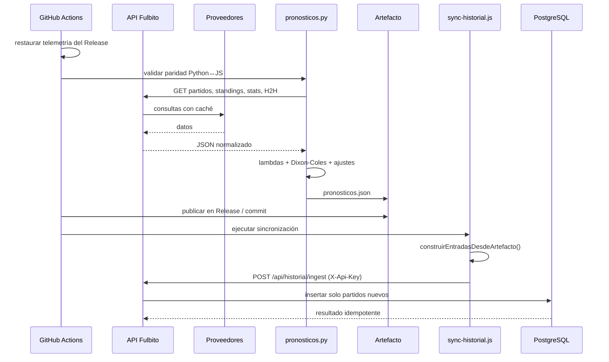
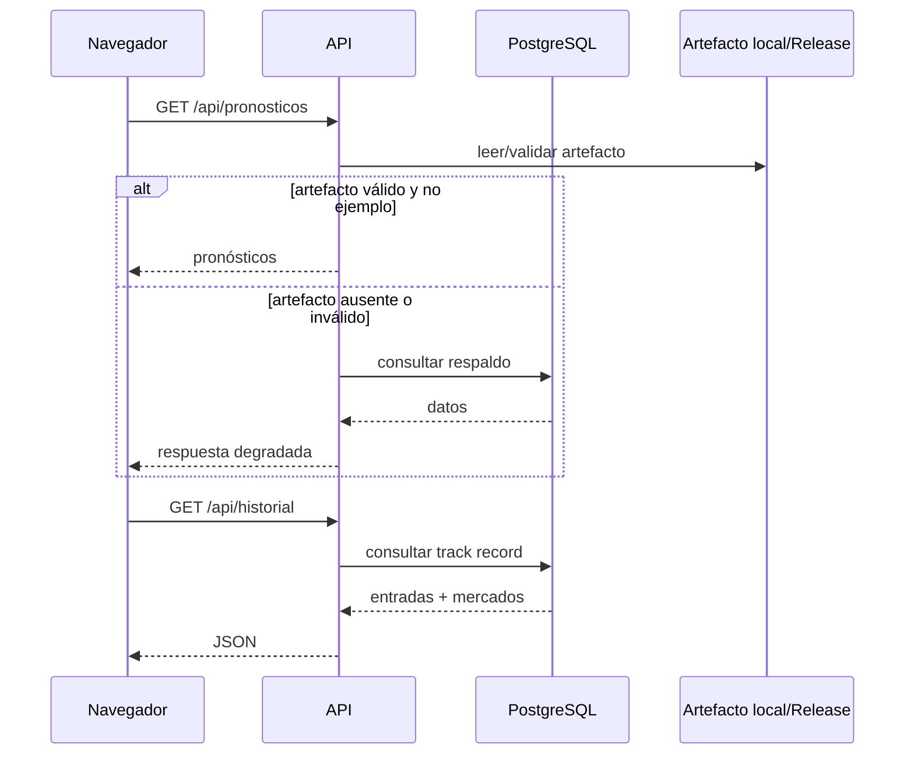
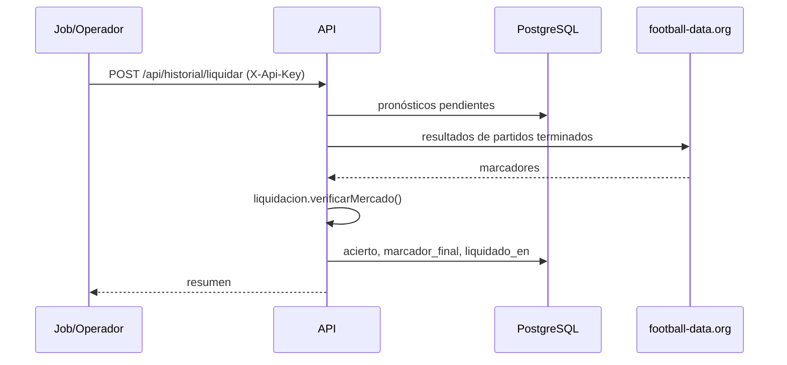
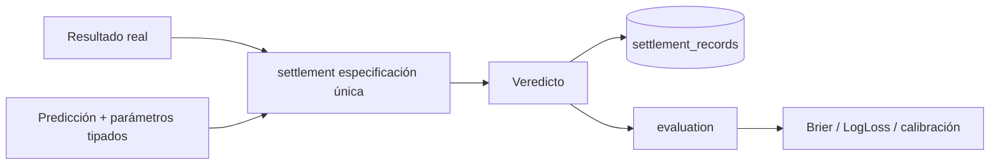
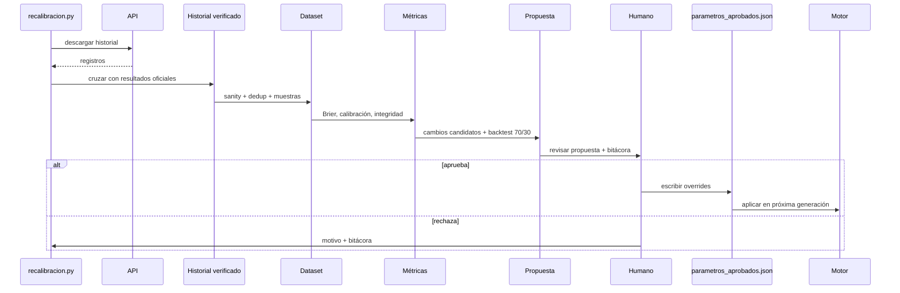
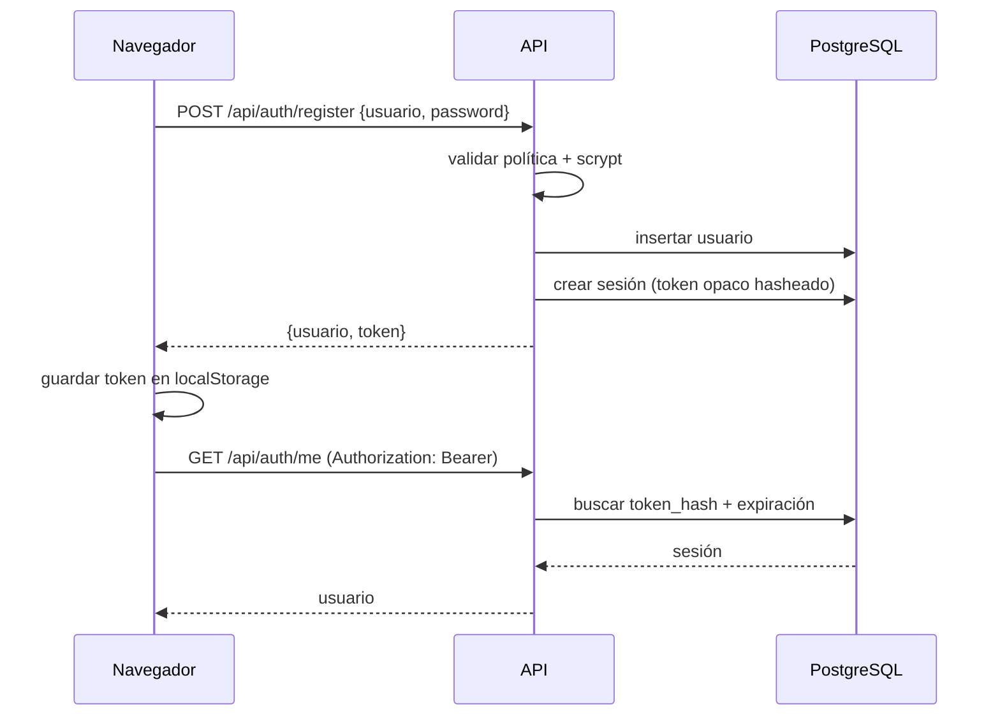
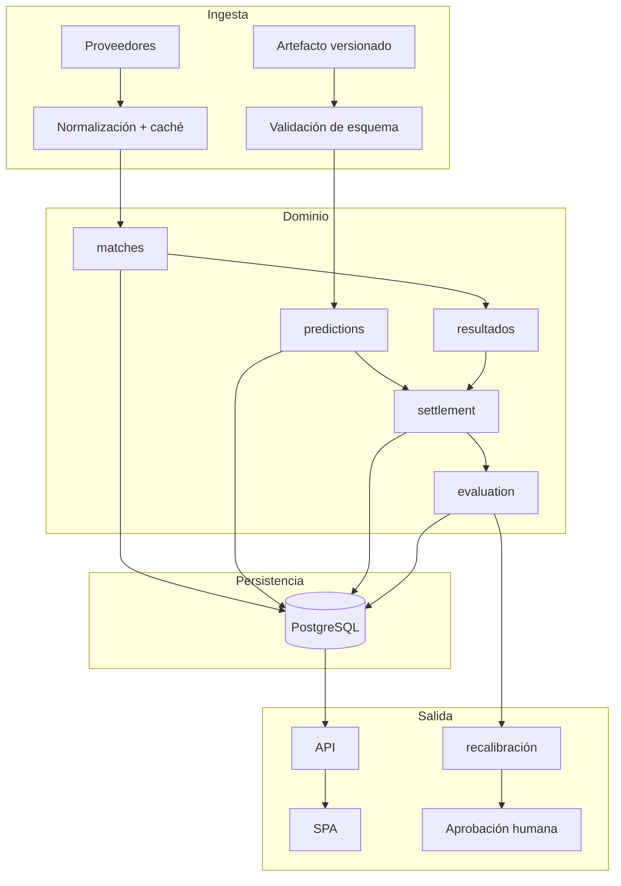

# Flujos de datos de Fulbito

> **Estado:** documentación de la fase 1. Describe el comportamiento actual y el flujo objetivo.
> **Relacionado:** [ARCHITECTURE.md](./ARCHITECTURE.md), [MODULES.md](./MODULES.md)

---

## 1. Principios del flujo

1. **Sin look-ahead.** Un pronóstico solo se registra antes de que el partido empiece.
2. **Idempotencia.** Reintentar una ingesta no duplica ni reescribe registros sellados.
3. **Trazabilidad.** Cada probabilidad debe poder rastrearse a partido, modelo, fecha e insumos.
4. **Una verdad por dato.** PostgreSQL para producción; artefactos para intercambio; `localStorage` solo para estado de UI.
5. **Aprobación humana.** La recalibración propone; un humano decide; el motor solo cambia tras aprobación.

---

## 2. Flujo diario de generación



### 2.1 Entradas

| Dato | Origen | Uso |
|---|---|---|
| Partidos por jugar | `GET /api/partidos` | universo de pronóstico |
| Tabla de posiciones | `GET /api/liga/:code/standings` | fuerza, posición, contexto |
| Stats de equipo | `GET /api/equipo/:id/stats` | goles, forma, localía |
| H2H | `GET /api/partido/:id/h2h` | ajuste de enfrentamiento |
| Cuotas (opcional) | `GET /api/odds/:sport` | valor esperado / Kelly |
| xG (opcional) | datos del partido | mezcla con goles reales |

### 2.2 Salida (`pronosticos.json`)

```json
{
  "version": "2.0",
  "generadoEn": "2026-10-08T15:37:12.081626+00:00",
  "modelo": {
    "tipo": "Poisson + Dixon-Coles",
    "rhoDixonColes": -0.04,
    "factorLocalia": 1.08,
    "mlUsado": false
  },
  "pronosticos": {
    "<partidoId>": {
      "partido": {
        "id": "555028",
        "homeTeam": { "id": 6685, "name": "Santos FC" },
        "awayTeam": { "id": 1783, "name": "CR Flamengo" },
        "competition": { "name": "Campeonato Brasileiro Série A", "code": "BSA" },
        "utcDate": "2026-10-08T22:30:00Z",
        "status": "TIMED"
      },
      "pronosticos": {
        "seleccionados": [
          {
            "categoria": "totalgoles",
            "parametros": { "linea": 1.5, "direccion": "mas" },
            "seleccion": "Más de 1.5 goles",
            "probabilidad": 70,
            "sinApuesta": false,
            "confianza": "Media",
            "contexto": "...",
            "explicacion": "..."
          }
        ]
      }
    }
  }
}
```

Invariantes del artefacto:

- `datosDeEjemplo: true` ⇒ **nunca** se registra en el track record.
- Solo se aceptan estados `TIMED`/`SCHEDULED`.
- Se exige `utcDate` válido y futuro (margen de 5 minutos en `historial-artefacto.js`).
- Una entrada por `partidoId`.
- Cada mercado debe tener `categoria` y `parametros`; la probabilidad es numérica o `null`.

### 2.3 Transformación a historial

`historial-artefacto.js` es la **única** fuente de conversión. Produce:

```json
{
  "partidoId": "555028",
  "local": "Santos FC",
  "visita": "CR Flamengo",
  "liga": "Campeonato Brasileiro Série A",
  "fecha": "2026-10-08T22:30:00Z",
  "mercados": [
    {
      "categoria": "totalgoles",
      "parametros": { "linea": 1.5, "direccion": "mas" },
      "seleccion": "Más de 1.5 goles",
      "probabilidad": 70
    }
  ],
  "verificado": false
}
```

Reglas de ingesta en la API:

- `POST /api/historial/ingest` es idempotente por `partidoId`.
- Nunca reemplaza un registro ya liquidado.
- Si el artefacto es de ejemplo, no inserta nada.
- La API responde con el resultado de la operación; el workflow no falla si faltan secretos (modo omitido).

---

## 3. Flujo de lectura pública



Notas actuales:

- La caché de proveedores es en memoria, acotada (máximo 200 entradas) y con TTL.
- El historial usa una caché en memoria con *debounce* de 500 ms antes de persistir.
- La respuesta debe conservar la forma que consume el frontend; cualquier cambio es aditivo.

---

## 4. Flujo de liquidación

### 4.1 Servidor (correcto)



Reglas de `server/liquidacion.js`:

- `resultado`: compara goles.
- `doble`: `1X` local≥visita, `X2` visita≥local, `12` distinto.
- `totalgoles`: `menos` ⇒ `total < linea`; `mas` ⇒ `total > linea`.
- `btts`: ambos anotan según `si`.
- `equipomarca`: el lado indicado anota ≥1.
- `handicap`: margen ≥ valor.
- `dnb`: gana el lado indicado en tiempo regular (sin empate).
- `marcador`: marcador exacto.

### 4.2 Cliente (defectuoso, P0)

`app-ui.js:562` llama a `verificarMercado` con cuatro argumentos. Esa ruta cae en `verificarMercadoAntiguo` (`app-model.js:1603`), que para `totalgoles`:

- lee `parametros.lineas` en vez de `parametros.linea`;
- ignora `direccion`;
- usa 3.5 por defecto.

Resultado: todo pick de goles se liquida como “más de 3.5”. El detalle completo y la remediación están en [ARCHITECTURE.md](./ARCHITECTURE.md), §8.

**Mientras no se corrija:**

- No usar el historial local del cliente para métricas de calidad.
- Tomar como verdad la liquidación server-side.
- Marcar cualquier Brier/calibración calculado en el navegador como no confiable para `totalgoles`.

### 4.3 Flujo objetivo



Una sola implementación de referencia (Python o JS puro) y *fixtures* compartidos para las demás. El servidor no debe depender del cliente para liquidar.

---

## 5. Flujo de evaluación y recalibración



### 5.1 Gates vigentes

| Gate | Umbral | Efecto |
|---|---|---|
| Muestra mínima | 50 partidos verificados | sin muestra no hay propuesta |
| Representatividad | ≥4 ligas con ≥5 partidos | habilita cambios de localía global |
| Movimiento máximo | 5% por corrida | limita saltos |
| Shrinkage | K=100 | estabiliza estimaciones |
| Split temporal | 70/30 | entrena/valida sin fuga |
| Mejora mínima | Brier 0.005 | evita cambios por ruido |
| Integridad | probabilidades no degeneradas | aborta dataset contaminado |
| Datos de ejemplo | `datosDeEjemplo` | aborta |

### 5.2 Contrato de propuesta

Campos observados en `recalibracion.py`:

```json
{
  "id": "prop-...",
  "generadoEn": "...",
  "estado": "propuesta",
  "dataset": {
    "partidosVerificados": 0,
    "muestrasMercados": 0,
    "ligas": {},
    "descartadosPorSanity": 0,
    "partidosDuplicadosDedup": 0,
    "muestrasExcluidasDeBacktestDeFactores": 0,
    "hashHistorial": "..."
  },
  "diagnostico": {
    "brierGlobal": 0,
    "porCategoria": {},
    "calibracionGlobal": []
  },
  "cambios": [
    {
      "parametro": "factorLocalia",
      "alcance": "global",
      "valorActual": 1.08,
      "valorPropuesto": 1.1,
      "mejora": 0.01,
      "nota": "..."
    }
  ],
  "cambiosVetados": [],
  "notaBacktesting": "..."
}
```

### 5.3 Contrato de aprobación

`parametros_aprobados.json`:

```json
{
  "overrides": {
    "calibracion": {
      "factorLocalia": 1.1,
      "porLiga": {},
      "porCategoria": {},
      "rhoDixonColes": -0.04,
      "limiteTabla": 0
    },
    "multiplicadoresAjuste": { "ewma": 1, "h2h": 1 },
    "platt": {}
  }
}
```

Reglas:

- El archivo se escribe **solo** tras aprobación humana.
- La bitácora registra corrida, propuesta, aprobación y rechazo.
- Kill switch: `FULBITO_IGNORE_APPROVED_PARAMS=1`; `--dry-run` valida sin escribir.
- Cada aplicación registra versión, actor y hash; pruebas en `test_gobernanza.py`.

> **Estado Fase 1:** el flujo fue alineado: merge ≠ aprobación; `aprobar_propuesta` escribe actor, versión, hash y log de generación; el PR ahora dice cómo aprobar. Detalle en `ARCHITECTURE.md §7.3.1`, `TESTING.md §6.2`, `SECURITY.md S-13`.

---

## 6. Flujo de autenticación



Notas:

- El token se guarda en `localStorage`; no hay cookie `HttpOnly`.
- La sesión dura 30 días y se prolonga con el uso.
- `logout` revoca la sesión actual; `logout-all` revoca todas.
- No hay verificación de email ni recuperación de contraseña.
- El frontend mantiene un modo anónimo con historial en `localStorage`.

---

## 7. Estados y fuentes de verdad

| Dato | Verdad | Réplica / caché | Riesgo |
|---|---|---|---|
| Usuarios y sesiones | PostgreSQL | — | sin recuperación de cuenta |
| Pronósticos globales | PostgreSQL | caché memoria + SQLite/JSON legacy | fuente ambigua |
| Mercados | PostgreSQL (`parametros` JSONB) | artefacto | parámetros sin tipar |
| Historial personal | PostgreSQL | `localStorage` | divergencia cliente/servidor |
| Pronósticos diarios | Artefacto (`pronosticos.json`) | Release / repo | crecimiento y desfase |
| Evaluación | `recalibracion.py` + bitácora JSONL | — | no consultable como DB |
| Parámetros aprobados | `parametros_aprobados.json` | — | sin auditoría en DB |

**Objetivo:** mover las tres últimas filas a PostgreSQL con historial inmutable, dejando los archivos como exportaciones.

---

## 8. Calidad de datos

Controles existentes en recalibración:

- Marcadores válidos y no absurdos.
- Deduplicación; un duplicado en conflicto no borra el registro limpio.
- Fechas coherentes.
- Cruce contra el histórico oficial del motor.
- Rechazo de probabilidades alteradas o degeneradas.
- Exclusión de picks sin histórico oficial.

Controles faltantes:

- Esquema validado en la frontera HTTP (por ejemplo, JSON Schema).
- Verificación de que `probabilidad` coincide con la probabilidad registrada por el motor.
- Detección de partidos duplicados entre competiciones.
- Monitorización de frescura del artefacto y de la liquidación.
- Reporte de cobertura por liga y mercado.

---

## 9. Flujo objetivo resumido



La diferencia clave con el estado actual no es tecnológica: es que **cada flecha tiene un contrato y un dueño**, y ninguna regla se implementa dos veces.
