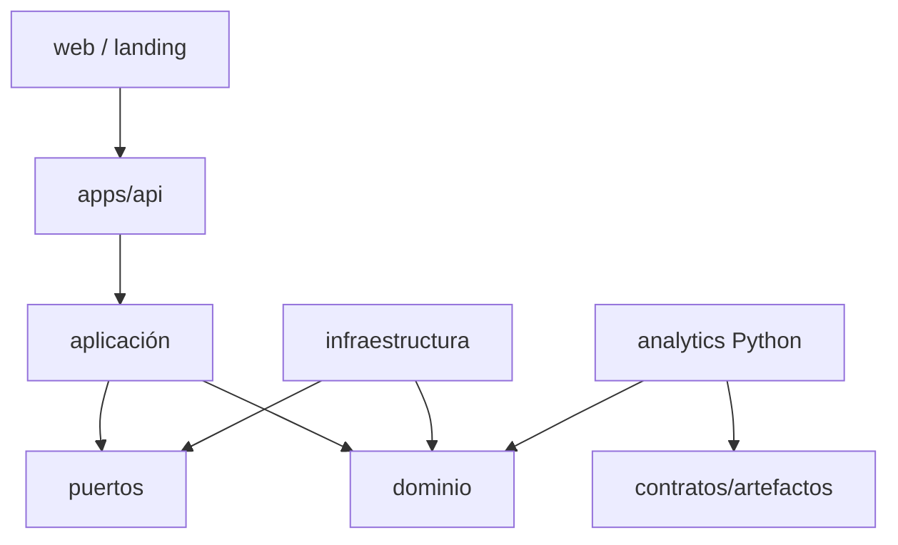

# Módulos, límites y contratos

> **Estado:** Fase 1 completada, Fase 2 en ejecución (2026-11-20).
> **Relacionado:** [ARCHITECTURE.md](./ARCHITECTURE.md), [ADR-001](./ADR-001-modular-monolith.md)

---

## 1. Mapa de módulos

| Módulo | Tipo | Responsabilidad | Implementación actual |
|---|---|---|---|
| `auth` | aplicación | registro, login, sesiones, logout + recuperación/auditores (Fase 9) | `server/server.js` (thin), `server/services/auth.js`, `server/services/recovery.js`, `server/services/audit.js`, `server/repositories.js`, `server/seguridad.js`, `auth.js` |
| `users` | aplicación | perfil e historial personal | `server/server.js` (`/api/mi-historial`), `server/repositories.js` |
| `repositories` | infraestructura | contratos de persistencia para usuarios/sesiones/historial personal y global | `server/repositories.js` |
| `settlement` | dominio | liquidación pura del track record | `packages/domain/settlement/index.js`; `server/liquidacion.js` facade |
| `matches` | aplicación | partidos, tablas, H2H, stats | `server/server.js` |
| `predictions` | aplicación | generar/leer pronósticos y mercados | `server/services/predictions.js`; `server/server.js` (thin) |
| `history` | aplicación | track record, ingesta y liquidación | `server/services/history.js`; `server/server.js` (thin) |
| `providers` | infraestructura | football-data, odds, RapidAPI | `server/server.js` |
| `models` | aplicación | versiones, parámetros, calibración, odds, motor de valor | `server/services/models.js`; `server/server.js` (thin) |
| `settlement` | dominio | contrato de liquidación único | `packages/domain/settlement/index.js`; `server/liquidacion.js` facade |
| `markets` | dominio | definición y validación de mercados | `pronosticos.py`, `app-model.js` |
| `evaluation` | dominio/analítica | Brier multiclase/binario, LogLoss, curvas, backtesting temporal, detección de sesgo, comparación OOS por versiones | `server/services/evaluation.js`; `server/services/evaluation-report.js`; `server/test-evaluation.js`; `server/test-evaluation-report.js` |
| `version` | dominio | `MODEL_VERSION` compartido | `packages/domain/version.js`; `pronosticos.py`; `server/services/models.js`; `server/test-version.js` |
| `data_quality` | analítica | control de calidad de insumos (duplicados, mercados inválidos, frescura, cobertura) | `recalibración.py`; `data_quality.py`; `test_data_quality.py` |
| `alertas` | analítica | alertas de salud del servicio (error rate, latencia P95, pool esperando) | `server/alertas.js`; `server/test-alertas.js` |
| `metrics` | analítica | contadores y latencia de infraestructura | `server/metrics.js`; `server/test-metrics.js`; `GET /api/metrics` |
| `recovery` | aplicación | recuperación de contraseñas (tokens hasheados, expiración) | `server/services/recovery.js`; `server/test-recovery.js` |
| `audit` | analítica | auditoría inmutable de aprobaciones (tabla PostgreSQL) | `server/services/audit.js`; `server/test-audit.js` |
| `ratings` | dominio | Elo y fuerzas multi-deporte | `backend_motores/`, `server.js` |
| `analytics` | analítica | pipeline y propuestas | `pronosticos.py`, `recalibracion.py` |
| `persistence` | infraestructura | PostgreSQL único, migraciones, repositorios, `password_reset_tokens`, `auditoria_aprobaciones` | `server/db.js`, `server/repositories.js` |
| `web` | presentación | SPA y estado de UI | `index.html`, `app-*.js`, `events.js` |
| `landing` | presentación | páginas públicas SEO | `web/` (Astro) |

---

## 2. Reglas de dependencia



Prohibiciones explícitas:

- `dominio` no importa Express, `pg`, `better-sqlite3`, `fs`, `fetch` ni DOM.
- `aplicación` no arma SQL ni conoce `req`/`res`.
- `web` no conoce la base de datos ni llama proveedores directamente.
- `analytics` no escribe en producción sin pasar por una propuesta aprobada.
- Ningún módulo lee variables de entorno de otro módulo; la configuración se inyecta.

---

## 3. Contratos internos propuestos

Los nombres son conceptuales; no implican crear archivos en esta fase.

### 3.0 `repositories` (infraestructura)

```ts
getUserByName(usuario: string): Promise<User | null>
getSessionByTokenHash(ht: string): Promise<Session | null>
createUser(usuario: string, passwordHash: string, salt: string): Promise<User>
createUserAndSession(usuario: string, passwordHash: string, salt: string, tokenHash: string, expira: string): Promise<User>
createSession(tokenHash: string, userId: string, expira: string): Promise<void>
revokeSessionsByUserId(userId: string): Promise<void>
revokeSessionByTokenHash(ht: string): Promise<void>
cleanupExpiredSessions(): Promise<void>
```

Reglas:

- Único pool PostgreSQL (`server/db.js`); sin capas de DB adicionales.
- Todo SQL vive aquí; `server/server.js` solo consume contratos.
- Las consultas de usuarios/sesiones usan transacciones solo si aplican.
- Pruebas: `npm run test:auth` (CI); sin `DATABASE_URL` se omite.

### 3.1 `auth`

```ts
register(input: { usuario: string; password: string }): Promise<Session>
login(input: { usuario: string; password: string }): Promise<Session>
logout(token: string): Promise<void>
logoutAll(userId: string): Promise<void>
resolveSession(token: string): Promise<User | null>
```

Reglas:

- Contraseña entre 8 y 128 caracteres.
- scrypt con salt único; comparación en tiempo constante.
- Token opaco de 32 bytes; se persiste solo su hash SHA-256.
- Sesión de 30 días con prolongación; `logout-all` revoca todas.
- Mensajes de error genéricos en login para no filtrar existencia.

### 3.2 `users`

```ts
getProfile(userId: string): Promise<Profile>
getPersonalHistory(userId: string): Promise<HistoryEntry[]>
replacePersonalHistory(userId: string, entries: HistoryEntry[]): Promise<void>
```

Deuda: `pronosticos_usuario.datos` es JSONB opaco; el objetivo es tipar mercados y permitir consultas.

### 3.3 `matches`

```ts
listMatches(filter: MatchFilter): Promise<Match[]>
getTeamStats(teamId: string): Promise<TeamStats>
getStandings(competition: string): Promise<Standing[]>
getHeadToHead(matchId: string): Promise<H2H>
getResult(matchId: string): Promise<Result | null>
```

Reglas:

- Validar y normalizar la respuesta del proveedor.
- Cachear con TTL y límite de tamaño.
- No exponer claves ni errores crudos del proveedor.
- Un fallo de proveedor degrada la respuesta; no debe tumbar la API.

### 3.4 `predictions`

```ts
generate(input: MatchInput): Promise<Prediction>
getByMatch(matchId: string): Promise<Prediction | null>
list(filter: PredictionFilter): Promise<Prediction[]>
```

Reglas:

- Python es la referencia numérica.
- Toda predicción incluye `modelVersion`, `generatedAt`, `inputHash` y mercados tipados.
- La probabilidad publicada es la calibrada y suavizada, no la cruda.
- Si no hay datos suficientes, se declara `sinApuesta` en lugar de inventar.

### 3.5 `history`

```ts
ingest(entries: HistoryEntry[]): Promise<IngestResult>
list(filter: HistoryFilter): Promise<HistoryEntry[]>
settle(matchId: string, result: Result): Promise<SettlementResult>
stats(): Promise<HistoryStats>
```

Reglas:

- Idempotente por `partidoId`.
- Nunca reescribe un registro liquidado.
- La liquidación es server-side y no depende del cliente.
- `stats` se calcula sobre registros verificados y con esquema válido.

### 3.6 `settlement` (dominio puro)

```ts
settleMarket(market: Market, result: Result): 'won' | 'lost' | 'void'
```

Especificación por categoría:

| Categoría | Regla |
|---|---|
| `resultado` | `local` gana, `visita` gana, `empate` igualdad |
| `doble` | `1X` local≥visita; `X2` visita≥local; `12` distinto |
| `totalgoles` | `menos`: total < línea; `mas`: total > línea |
| `btts` | ambos ≥1 si `si`; lo contrario si no |
| `equipomarca` | el lado indicado ≥1 |
| `handicap` | margen del lado ≥ valor |
| `dnb` | gana el lado en tiempo regular; empate ⇒ nulo |
| `marcador` | coincide `gl` y `gv` |

**Esta tabla es la especificación única.** Debe existir un fixture por fila, compartido por Python, JS y servidor. El servidor usa `packages/domain/settlement/index.js`; cliente y Python conservan copias por paridad (`test:parity`, `test:settlement`).

### 3.7 `models`

```ts
listVersions(): Promise<ModelVersion[]>
getActiveVersion(): Promise<ModelVersion>
proposeRecalibration(dataset: Dataset): Promise<Proposal>
approve(proposalId: string, actor: string): Promise<ApprovedParameters>
reject(proposalId: string, actor: string, reason: string): Promise<void>
```

Reglas:

- Una versión es inmutable.
- Aprobar crea una versión nueva; no muta la anterior.
- Toda decisión queda en `audit_log`.
- Los gates de recalibración no son configurables por el cliente.

### 3.8 `evaluation`

```ts
brier(samples: Sample[]): number
logLoss(samples: Sample[]): number
calibration(samples: Sample[], bins: number): CalibrationBin[]
backtest(dataset: Dataset, split: Split): BacktestResult
compareVersions(a: ModelVersion, b: ModelVersion): Comparison
biasBySegment(samples: Sample[], segment: string): BiasReport
```

Reglas:

- Métricas reproducibles: mismo dataset y versión ⇒ mismo resultado.
- Reportar `n` junto a cada métrica; no publicar métricas con muestra insuficiente.
- El backtesting respeta el orden temporal; nunca mezcla futuro con pasado.
- La comparación de versiones usa el mismo conjunto out-of-sample.

### 3.9 `providers`

Puertos:

```ts
interface MatchProvider { listMatches(filter): Promise<RawMatch[]>; getResult(id): Promise<RawResult> }
interface OddsProvider { getOdds(sport): Promise<RawOdds[]> }
interface StatsProvider { getTeamStats(id): Promise<RawStats>; getStandings(code): Promise<RawStanding[]> }
```

Reglas:

- Timeout, reintentos acotados y circuit breaker simple.
- Caché con TTL y límite de entradas.
- Claves solo desde entorno.
- Respuestas normalizadas antes de entrar al dominio.

### 3.10 `persistence`

```ts
interface PredictionRepository { save(p): Promise<void>; findByMatch(id): Promise<Prediction | null> }
interface HistoryRepository { ingest(entries): Promise<IngestResult>; list(filter): Promise<HistoryEntry[]> }
interface UserRepository { create(...): Promise<User>; findByUsername(...): Promise<User | null> }
interface SessionRepository { create(...): Promise<void>; findValid(...): Promise<Session | null>; revoke(...): Promise<void> }
```

Reglas:

- Una transacción por operación de negocio.
- Sin SQL en controladores.
- Migraciones idempotentes y versionadas.
- Un solo pool por proceso.

---

## 4. Duplicación: inventario y decisión

| Regla | Copias actuales | Divergencia | Decisión |
|---|---|---|---|
| `verificarMercado` | `pronosticos.py`, `app-model.js`, `server/liquidacion.js` | **Sí, pero resuelto: fixtures compartidos y paridad en 57/57** | especificación única + fixtures + pruebas |
| Poisson / Dixon-Coles | `pronosticos.py`, `app-model.js` | No (paridad 1e-9) | mantener paridad obligatoria |
| Elo básquet | `backend_motores/motor_basquet.py`, `server.js` | No verificada | unificar en dominio `ratings` |
| Tenis | `motor_tenis.py`, `backend_motores/motor_tenis.py` | **Sí** (K, superficie, saque) | elegir canónico con evidencia |
| Vóley | `motor_voley.py`, `backend_motores/motor_voley.py` | **Sí** (real vs placeholder) | canónico real + adapter |
| Calibración | `recalibracion.py`, `app-ui.js` | Parcial | evaluación solo en analítica |
| Normalización de artefacto | `historial-artefacto.js`, `server.js` | Posible | una sola función |

### 4.1 Tenis

`motor_tenis.py` (raíz) y `backend_motores/motor_tenis.py` difieren en:

- K-factor (16 vs 32).
- Forma del Elo por superficie.
- Modelo de servicio adicional en la versión raíz.

No se puede declarar equivalencia sin una comparación con datos reales. Propuesta: congelar ambos, ejecutar un backtest out-of-sample con el mismo dataset y elegir el de mejor Brier/Log Loss; el otro se retira con un período de convivencia.

### 4.2 Vóley

`backend_motores/motor_voley.py` devuelve explícitamente “Motor en desarrollo.” y el endpoint puede responder un partido placeholder. `motor_voley.py` (raíz) implementa Elo y distribución de sets. Riesgo: un usuario puede recibir un pronóstico no real como si lo fuera.

Propuesta inmediata (sin cambiar el motor): etiquetar la respuesta como `experimental`/`sinDatos` y no registrarla en el track record hasta que el motor real esté conectado y probado.

### 4.3 Básquet

El motor Python usa Elo + pace/eficiencia; `server.js` replica lógica Elo en JS. No hay prueba de paridad. Propuesta: mover el cálculo a `ratings` y consumirlo desde ambos lados, o declarar Python canónico y hacer que JS solo presente.

---

## 5. Mapa de archivos actuales

| Archivo | Líneas | Responsabilidad actual | Módulo destino |
|---|---:|---|---|
| `server/server.js` | 1.926 | todo el backend | `auth`, `users`, `matches`, `history`, `providers`, `models` |
| `server/db.js` | 151 | pool + migraciones | `persistence` |
| `server/seguridad.js` | 153 | primitivas de seguridad | `auth` (infra) |
| `server/liquidacion.js` | 147 | settlement puro | `settlement` |
| `pronosticos.py` | 2.009 | motor + ingesta + CLI | `analytics` + `predictions` |
| `recalibracion.py` | 1.457 | métricas + propuestas | `evaluation` + `models` |
| `backend_motores/base_motor.py` | — | interfaz de motores | `ratings` |
| `backend_motores/motor_basquet.py` | — | Elo básquet | `ratings` |
| `backend_motores/motor_tenis.py` | — | Elo tenis (divergente) | `ratings` |
| `backend_motores/motor_voley.py` | — | placeholder | `ratings` (reemplazar con canónico) |
| `historial-artefacto.js` | 63 | artefacto → historial | `history` |
| `sync-historial.js` | 93 | ingesta | `history` |
| `app-model.js` | 2.177 | config + red + estado + motor + UI | `web` + `predictions` |
| `app-ui.js` | 2.069 | render + historial + métricas | `web` |
| `app-init.js` | 922 | bootstrap + modales + combinadas | `web` |
| `events.js` | — | despachador central | `web` |
| `auth.js` | — | sesión cliente | `web` |
| `v-multideporte.js` | — | vista multi-deporte | `web` |
| `web/` | — | landing Astro | `landing` |

---

## 6. Orden de extracción recomendado

1. **`settlement`** — puro, crítico, ya duplicado. Primer módulo con pruebas compartidas.
2. **`markets`** — definiciones y validación; habilita tipar `prediction_markets`.
3. **`evaluation`** — métricas puras; hoy mezcladas con UI y CLI.
4. **`persistence`** — repositorios y un solo pool; elimina SQL de controladores.
5. **`history`** — ingesta y liquidación sobre repositorios.
6. **`predictions`** — orquestación del motor; Python como servicio interno o CLI.
7. **`auth` / `users`** — ya están razonablemente aislados; formalizar contratos.
8. **`web`** — módulos ES, estado acotado, sin globals.

Cada extracción sigue el mismo ritual:

1. Congelar comportamiento con pruebas.
2. Mover código sin cambiar lógica.
3. Verificar paridad y suite completa.
4. Recién entonces mejorar.

---

## 7. Antipatrones prohibidos

- **God object:** volver a concentrar rutas, SQL y reglas en un archivo.
- **Shared database:** dos módulos escribiendo la misma tabla sin contrato.
- **Hidden dependency:** leer `process.env` o `window` dentro del dominio.
- **Magic constants:** líneas, umbrales y categorías dispersos; deben vivir en `markets`/config.
- **Copy-paste parity:** replicar una fórmula sin fixture de paridad.
- **Silent fallback:** devolver datos de ejemplo sin marcarlos como tales.
- **Metrics without n:** publicar Brier o calibración sin tamaño de muestra.
- **Auto-apply:** cambiar parámetros de producción sin aprobación humana.
