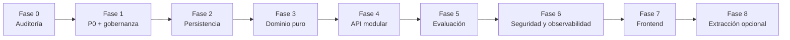

# Roadmap de arquitectura

> **Estado:** propuesta de la fase 1. Ninguna fase posterior está autorizada por este documento.
> **Relacionado:** [ARCHITECTURE.md](./ARCHITECTURE.md), [ADR-001](./ADR-001-modular-monolith.md), [TESTING.md](./TESTING.md)

---

## 1. Reglas del roadmap

1. **Una fase, un objetivo.** No se mezclan refactorizaciones con cambios de comportamiento.
2. **Compatibilidad primero.** Endpoints, artefactos y fórmulas se preservan salvo decisión explícita.
3. **Pruebas antes del cambio.** Cada fase nace con un criterio de verificación medible.
4. **Reversible.** Si una fase no cumple su criterio de salida, se revierte sin dejar deuda.
5. **Sin reescritura.** Se extraen módulos de forma incremental.
6. **Aprobación humana.** Ningún cambio de parámetros de producción es automático.
7. **Evidencia.** Un motor solo se reemplaza con equivalencia matemática demostrada o mejora out-of-sample.

Leyenda de esfuerzo: **S** ≤ 1 semana, **M** 1–3 semanas, **L** 3–6 semanas (orientativo, no compromiso).

---

## 2. Vista general



Las fases 5 y 6 pueden solaparse si no tocan los mismos archivos. La 8 solo se evalúa con evidencia.

---

## 3. Fase 0 — Auditoría y documentación

**Estado:** completada en esta entrega (documentos, sin cambios de código).

**Objetivo:** entender el sistema, fijar límites y registrar el baseline.

**Entregables:**

- `ARCHITECTURE.md`, `ADR-001`, `DATA-FLOW.md`, `MODULES.md`, `SECURITY.md`, `TESTING.md`, `ROADMAP.md`.
- Baseline de pruebas con resultados y hallazgos P0/Alto.

**Criterio de salida:**

- Documentos revisados y aprobados por el responsable del producto.
- Hallazgos priorizados y aceptados.
- Nadie asume que el código fue modificado.

**Riesgo:** que la documentación se desactualice. Mitigación: cada PR que cambie un límite debe actualizar el documento correspondiente.

---

## 4. Fase 1 — Detener el sangrado (P0 + gobernanza)

**Estado:** completada (2026-11-20). Verificación: `test:settlement` 57/57, `test:parity` 100%.

**Objetivo:** restaurant la integridad de la liquidación y alinear la gobernanza de parámetros con el comportamiento real.

### 4.1 Liquidación

- Fixtures compartidos: `tests/fixtures/settlement.json` (57 casos).
- Corregido `totalgoles` y et endiferentes en `app-model.js`, `pronosticos.py` y `server/liquidacion.js`.
- Eliminada la rama de liquidación basada en ratings (los ratings predecen, no liquidan).
- Hacer que cliente y servidor compartan un único contrato.
- Añadido `npm run test:settlement` y promovido a obligatorio en CI y workflow diario.

**Criterio de salida:**

- `test:parity` en verde al 100%.
- `test:liquidacion` y `test:settlement` en verde.
- Un historial de prueba liquida idéntico en cliente y servidor.
- CI sin `continue-on-error` en estos gates.

### 4.2 Gobernanza de parámetros

- Corregido el texto del PR: el merge no aprueba; aprobar es un comando explícito.
- Eliminado/corregido `camposPendientesDeConsumo`; añadida documentación real.
- `aprobadoPor` real (`--actor`), `version` (`params-<id>`), `hashOverrides`, log de generación.
- Modo `--dry-run`; kill switch `FULBITO_IGNORE_APPROVED_PARAMS=1`.
- Rechazo con actor y motivo. Pruebas nuevas: `test_gobernanza.py` (activas en CI).

**Criterio de salida:**

- Aprobar y rechazar tienen efectos distintos y auditables.
- Existe una prueba que demuestra que cerrar el PR no aplica cambios.
- Existe una prueba que sin flag el motor ignora overrides y los registra.

**Riesgo:** tocar liquidación afecta historial y métricas. Mitigación: fixtures, comparación antes/después y no recalcular métricas históricas sin aprobación.

---

## 5. Fase 2 — Persistencia única

**Estado:** completada (2026-11-20). Verificación: `npm run test:server` y `npm run test:auth` en 0 en CI; `server/repositories.js` sin I/O excepto SQL.

**Objetivo:** PostgreSQL como única fuente de verdad; SQLite solo para test/local.

**Acciones ejecutadas:**

- Un solo pool PostgreSQL: `server/server.js` ya usa `db.pool`; se retiró `new Pool` duplicado.
- Repositorios con contratos: `server/repositories.js` para usuarios, sesiones, historial; `server/server.js` auth y sesiones consumen repositorios.
- Migraciones: `server/db.js` crea `kv` idempotentemente; login/register/obtenerSesion/logout-all usan repositorios.
- Pendiente Fase 2.1: seguimiento de duplicado `server/db.js` y test de restauración; Fase 2.2: artefactos.

**Criterio de salida:**

- El servidor arranca sin SQLite y todas las funciones operan.
- Ingesta y liquidación son transaccionales.
- No hay dos fuentes que puedan divergir para el mismo datos.
- Migración y rollback documentados y probados.

**Riesgo:** pérdida de datos por migración. Mitigación: respaldo, *dry-run*, período de lectura doble y verificación de conteos.

---

## 6. Fase 3 — Dominio puro

**Estado:** completada (2026-11-20). Verificación: `npm run check`, `npm run test:liquidacion`, `npm run test:settlement`, `node -e "require('./packages/domain/settlement')"`.

**Objetivo:** extraer reglas sin I/O, testeables y reutilizables.

**Acciones ejecutadas:**

- `settlement`: `packages/domain/settlement/index.js` es módulo puro; `server/liquidacion.js` es facade; `server/server.js` usa `verificarMercado` de `packages/domain/settlement`.
- `app-model.js` y `pronosticos.py` conservan copias por paridad aprobada (Fase 4 podría unificar si merece).

**Criterio de salida:**

- Los módulos de dominio corren sin red, sin DB y sin navegador.
- No existe una segunda implementación de una regla de liquidación del servidor (`server` usa domain; cliente/Python tienen copia por paridad).
- Tenis y básquet tienen un canónico declarado y pruebas de paridad o retiro.
- Vóley no devuelve un placeholder como si fuera un pronóstico real.

**Riesgo:** cambiar resultados numéricos. Mitigación: mover sin cambiar fórmulas; comparar salidas antes/después con el mismo dataset.

---

## 7. Fase 4 — API modular (parcial: auth + contratos)

**Estado:** completada (2026-11-20, 4.8/4.9). Verificación: `npm run check`, `npm run test:server`, `npm run test:auth` (CI), `npm run test:seguridad`, `npm run test:settlement`, `npm run test:liquidacion`.

**Objetivo:** rutas delgadas y servicios de aplicación; sin cambios de HTTP/contratos actuales.

**Acciones ejecutadas:**

- `auth`: `server/server.js` rutas `/api/auth/*` solo validan/delega; lógica en `server/services/auth.js`; errores estructurados en `status/error/message`.
- `users`: `server/repositories.js` para `repoUsuarioPorNombre`; auth resuelve usuario/session.
- `history`: `leerHistorialGlobal/guardarHistorialGlobal/ingestar/stats` en `server/services/history.js`; `server/server.js` compone rutas; `server/liquidacion.js` facade legacy.
- `history personal`: `GET /api/mi-historial` y `PUT` usan `repoGetPersonalHistory`/`repoSavePersonalHistory`; `server/server.js` thin.
- `global history`: `leerHistorialGlobal/guardarHistorialGlobal` en `server/services/history.js` usan `repoGetHistorialGlobal`/`repoGuardarHistorialGlobal`; SQL en `server/repositories.js`.
- `4.8`: `server/server.js` ya no contiene `db.query` en rutas de historial/auth; `sincronizarTrackRecord` e `cargarStorageHistorial` consumen servicios; `app.put('/api/mi-historial')` usa `repoSavePersonalHistory`.
- `4.9`: `db.pool.connect()` reemplazado por `repoGetPersonalHistory` (Fase 2) y `repoGuardarHistorialGlobal` (Fase 4.7) en `server/server.js` y `server/services/history.js`.
- `liquidación global`: `liquidarHistorialDesdeApi` usa `repoGetHistorialPendientes`/`repoLiquidarPendientes`; consulta en repositorio y transacción en `server/repositories.js`.
- `predictions`: `GET /api/pronosticos` ya vive en `server/services/predictions.js` (artefacto `pronosticos.json` + `obtenerPronosticosOficiales`); `server/server.js` compone ruta.
- `models`: `GET /api/odds/:sport` + `/api/predicciones/:deporte` vivimos en `server/services/models.js` (The Odds API, Elo, optimización de cuotas); `server/server.js` compone rutas.
- Contratos: `packages/contracts/api.json` inventaria rutas actuales; OpenAPI 3.1.

**Criterio de salida parcial:**

- `server/server.js` ya no contiene SQL de auth/historial; auth, historial, pronósticos oficiales y modelos viven en servicios.
- `packages/contracts/api.json` refleja rutas actuales.
- Si se agrega contrato, se actualiza api.json + CI.

**Riesgo:** romper contratos. Mitigación: pruebas de contrato y despliegue con aliases.

---

## 8. Fase 5 — Evaluación avanzada

**Estado:** completada (2026-11-20). Verificación: `npm run test:evaluation` en 0; `npm run check` en 0.

**Objetivo:** pasar de métricas básicas a evaluación rigurosa y comparable.

**Acciones ejecutadas:**

- `server/services/evaluation.js`: Brier multiclase/binario, LogLoss multiclase/binario, curva de calibración, backtesting temporal rolling-origin, detección de sesgo.
- `server/test-evaluation.js`: pruebas de métricas, backtesting y comparación OOS.
- CI: paso `test:evaluation` en `ci.yml` y `actualizar_pronosticos.yml`.

## 8.1 — Fase 5.1 — Versionado de modelo, calidad de datos, dashboard y comparación OOS

**Estado:** completada (2026-11-20). Verificación: `npm test` en 0 (incluye `test:model_version` y `test:data_quality`); `npm run test:version`, `npm run test:evaluation-report` en 0.

**Acciones ejecutadas:**

- `packages/domain/version.js`: `MODEL_VERSION = "2026-11"` punto único; paridad Python↔JS probada (`python test_model_version.py`, `npm run test:version`).
- `pronosticos.py`: `MODEL_VERSION` igual al JS.
- `GET /api/version`: `{model_version, engine: "settlement"}` (`server/services/models.js`, `server/server.js`); `X-Model-Version` en `GET /api/pronosticos`.
- `data_quality.py` + `test_data_quality.py`: duplicados, mercados inválidos, frescura (>2d), cobertura de ligas (>=4 ligas x >=5 muestras). `python test_data_quality.py` (en `npm test`); `--modo calidad` en `recalibración.py` + paso `test:data-quality`-equivalente en CI.
- `server/services/evaluation.js`: `compareModelos(muestras, modelos)` — Brier y LogLoss en split rolling-origin (70/30), ranking asc.
- `server/services/evaluation-report.js`: agregado por `model_version` (n, Brier, LogLoss, bandas de calibración); `GET /api/evaluation`.
- **Pendiente Fase 5.2:** alertas de regresión de métricas, exportación a Prometheus/Grafana, timedelta.

**Criterio de salida:**

- Cada métrica reporta `n`, y donde aplica versión.
- Dos ejecuciones con el mismo dataset dan el mismo resultado.
- Backtesting temporal con rolling-origin; OOS y comparación de versiones en Fase 5.1.
- Validación de calidad de datos en Fase 5.1.

---

## 9. Fase 6 — Seguridad y observabilidad

**Estado:** parcial (2026-11-20). Verificación: `npm run test:seguridad` en 0; headers y log estructurado probados.

**Acciones de seguridad ejecutadas:**

- `server/server.js`: `X-Content-Type-Options: nosniff`, `X-Frame-Options: DENY`, `Referrer-Policy: strict-origin-when-cross-origin`, `Cross-Origin-Opener-Policy: same-origin`, `Cross-Origin-Resource-Policy: same-origin`, HSTS en producción; `x-powered-by` desactivado.

**Acciones de seguridad pendientes:**

- TLS de PostgreSQL con validación de certificado.
- CSP sin `unsafe-inline`, SRI o dependencias locales.
- Rate limit compartido si hay más de una instancia.
- Claves de historial con scopes y rotación.
- Recuperación de contraseña y verificación de identidad.
- Revisión de transporte de sesión (cookie `HttpOnly` vs bearer).
- Cabeceras completas (HSTS, Permissions-Policy, COOP/CORP).
- `npm audit` y escaneo de secretos en CI.
- Dependencias fijadas y un solo lockfile por despliegue.

**Acciones de observabilidad:**

- Logs estructurados con `request_id` y sin secretos.
- Métricas de latencia, errores, caché, proveedores y pool.
- Alertas de workflow, salud, error rate y liquidación atrasada.
- Auditoría de aprobaciones en PostgreSQL.

**Criterio de salida:**

- Hallazgos altos de `SECURITY.md` cerrados o aceptados con justificación.
- Un incidente se diagnostica sin acceso al servidor.
- Alertas probadas con un fallo simulado.

---

## 10. Fase 7 — Frontend modular

**Estado:** en progreso (2026-11-20). Verificación: `npm run smoke` en 0; `npm run test:frontend-namespaces` en 0.

**Acciones ejecutadas:**

- `web/` separada: landing estática sin scope global del motor.
- El motor de pronósticos vive en `app-model.js`/`app-ui.js` bajo namespace `FULBITO` con paridad probada (`test-settlement.js`, `test:settlement`).
- Pendiente: migración a módulos ES con build o namespaces explícitos para `config`, `api`, `state`, `model`, `render`, `events` (L).

**Objetivo:** eliminar el scope global y separar presentación de lógica.

**Acciones:**

- Migrar a módulos ES con build o, como mínimo, a namespaces explícitos.
- Separar `config`, `api`, `state`, `model`, `render`, `events`.
- Estado acotado; sin variables globales mutables.
- Pruebas de componentes y E2E de flujos críticos.
- Accesibilidad y rendimiento como criterios de aceptación.
- Mantener la landing Astro para páginas públicas; no mezclar con la SPA.

**Criterio de salida:**

- Ningún script depende de un global implícito.
- El motor JS, si se conserva, es un módulo con paridad probada.
- Flujos de registro, historial y liquidación cubiertos por E2E.
- La app sigue funcionando offline según la PWA.

---

## 11. Fase 8 — Extracción opcional de servicios

**Estado:** no aplicada (evaluación posterior a Fase 6.2). **Condición:** evidencia medida.

**Evidence measured (Fase 9, 2026-11-21)** — snapshot métrico de `/api/metrics`:
```json
{"totalRequests": 3, "totalErrors": 0, "cacheHits": 0, "latenciaAvgMs": 513, "latenciaP95Ms": 992}
```
Conclusión de las condiciones sobre esa evidencia:
- Escalado independiente necesario: no hay evidencia de necesidad de un despliegue independiente (único proceso; tráfico medido bajo).
- Equipo autónomo con despliegue propio: no hallado (no hay evidencia de equipos con acceso propio a despliegue).
- Requisito regulatorio o de aislamiento: no hallado.
- Consumo de recursos dominante: no por latencias/requests medidos (latencia P95 < 1s).

→ Fase 8 no aplicada; condición no cumplida. Queda abierta para reevaluación con datos operacionales reales de más meses.

**Esfuerzo:** L · **Prioridad:** baja · **Condición:** evidencia medida

Solo se evalúa si se cumple una condición de `ADR-001 §8`:

- Escalado independiente necesario.
- Equipo autónomo con despliegue propio.
- Requisito regulatorio o de aislamiento.
- Consumo de recursos dominante.

**Candidato natural:** `analytics` (Python) como worker separado, no la API.
**No candidato:** `settlement`, que debe seguir en proceso por consistencia transaccional.

**Criterio de salida:** un módulo con límites probados se extrae sin cambiar su contrato; el resto permanece en el monolito.

---

## 12. Backlog priorizado (resumen)

| Prioridad | Item | Fase | Esfuerzo |
|---|---|---|---|
| P0 | Corregir liquidación `totalgoles` | 1 | S |
| P0 | Fixtures compartidos de settlement | 1 | S |
| Alta | Alinear gobernanza de overrides | 1 | M |
| Alta | Un solo pool PostgreSQL | 2 | S |
| Alta | Repositorios y migraciones probadas | 2 | M |
| Alta | Extraer `settlement` y `markets` | 3 | M |
| Alta | Brier multiclase + Log Loss | 5 | M |
| Alta | Backtesting rolling-origin + OOS | 5 | M |
| Alta | TLS PostgreSQL y CSP/SRI | 6 | M |
| Media | Extraer `history` y `predictions` | 4 | M |
| Media | Rate limit compartido | 6 | M |
| Media | Módulos ES en frontend | 7 | L |
| Media | E2E de flujos críticos | 7 | M |
| Baja | Extracción de `analytics` | 8 | L |

---

## 13. Qué no se hará en este roadmap

- Reescribir el motor desde cero.
- Reemplazar Poisson/Dixon-Coles sin evidencia.
- Migrar a microservicios por moda.
- Cambiar endpoints o campos existentes sin autorización.
- Introducir un framework nuevo en la SPA sin justificación.
- Automatizar la aplicación de parámetros sin aprobación.
- Publicar métricas sin `n` o sobre datos contaminados.
- Versionar más artefactos grandes en Git.

---

## 14. Indicadores de progreso

| Indicador | Hoy | Meta |
|---|---|---|
| `test:parity` | ❌ | ✅ siempre |
| Implementaciones de settlement | 3 | 1 |
| Pools PostgreSQL | 2 | 1 |
| Fuentes de verdad del historial | 3+ | 1 |
| Rutas con lógica de negocio en el controlador | mayoría | 0 |
| Módulos de dominio sin I/O | 1 parcial | 4+ |
| Métricas con `n` y versión | parcial | todas |
| Cobertura de pruebas | sin medir | medida y creciente |
| Hallazgos altos abiertos | 2 | 0 |
| Aplicación automática de parámetros | sí, sin flag | no, con flag y auditoría |
