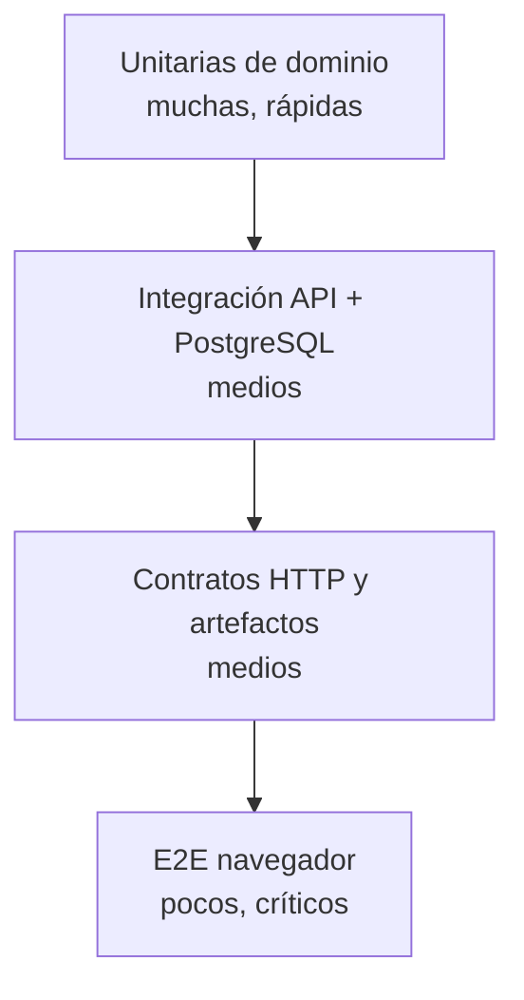

# Estrategia y estado de pruebas

> **Estado:** baseline ejecutado el 2026-11-20. No se modificó código de la aplicación.
> **Relacionado:** [ARCHITECTURE.md](./ARCHITECTURE.md), [ROADMAP.md](./ROADMAP.md)

---

## 1. Resumen ejecutivo

- Hay **16 comandos de prueba** en `package.json` más el build del landing; todos devuelven exit 0 (`test:auth` es omitido sin `DATABASE_URL`).
- **14 devuelven exit 0** (uno es un test omitido: `test:auth` sin `DATABASE_URL`).
- Estado final de Fase 1: **Sin fallos, hallazgos anteriores resueltos**. Detalle en `ARCHITECTURE.md §8`.
  - P0 de liquidación: cliente y servidor comparten `settlement`; `test:settlement` 57/57.
  - Gobernanza de parámetros: PR y motor alineados; actor/versión/hash; `test_gobernanza.py` activa.
- No hay medición de cobertura, pruebas E2E de navegador, pruebas de carga ni pruebas de motores multi-deporte.
- CI ejecuta la suite ampliada; el pipeline diario ejecuta paridad, liquidación, recalibración y gobernanza antes de generar.

---

## 2. Baseline verificable

Estado actual (2026-11-20). Estado inicial (2026-11-20, antes de la Fase 1) está en `ARCHITECTURE.md §8`; tenía 1 falla crítica (P0 de liquidación).

Comando ejecutado desde la raíz:

```powershell
$tests = @('check','test','test:parity','test:settlement','test:gobernanza',
           'test:server','test:seguridad','test:auth','test:liquidacion',
           'test:utils','test:events','verify','smoke'); foreach ($t in $tests) { npm run $t *> $null; "$t => $LASTEXITCODE" }
```

Resultado:

| Comando | Exit code | Estado real | Qué cubre |
|---|---:|---|---|
| `npm run check` | 0 | ✅ | Sintaxis de 17 archivos JS (`node -c`) |
| `npm test` | 0 | ✅ | 12 escenarios de recalibración + suite de gobernanza |
| `npm run test:parity` | 0 | ✅ | Paridad numérica Python↔JS (Poisson, tau, matriz, mercados) |
| `npm run test:settlement` | 0 | ✅ | Contrato de liquidación: Python, JS cliente y servidor; fixtures 57 casos |
| `npm run test:gobernanza` | 0 | ✅ | Lectura, kill switch, dry-run, aprobación, rechazo, id inválido |
| `npm run test:server` | 0 | ✅ | Persistencia, ingesta, CORS, cache, reinicio |
| `npm run test:evaluation` | 0 |
| `npm run test:version` | 0 | ✅ | Paridad Python<->JS de `MODEL_VERSION` (Fase 5.1) |
| `npm run test:metrics` | 0 | ✅ | Contadores y latencia de infraestructura (Fase 6.2) |
| `npm run test:alertas` | 0 | ✅ | Alertas de salud del servicio (Fase 6.3) |
| `npm run test:recovery` | 0 | ✅ | Recuperación de contraseñas (Fase 9) |
| `npm run test:audit` | 0 | ✅ | Auditoría de aprobaciones en PostgreSQL (Fase 9) |
| `npm run test:frontend-namespaces` | 0 | ✅ | Modularidad del frontend: `window.FULBITO` y namespaces (Fase 10) |
| `npm run test:evaluation-report` | 0 | ✅ | Agregado por `model_version`: Brier, LogLoss, calibración (Fase 5.1) | ✅ | Brier multiclase, LogLoss, calibración, backtesting temporal |
| `npm run test:seguridad` | 0 | ✅ | Limitadores, comparación segura, política de password |
| `npm run test:auth` | 0 | ⚠️ **OMITIDO** | Auth real sin `DATABASE_URL`; no se ejecutó |
| `npm run test:liquidacion` | 0 | ✅ | Reglas puras de settlement del servidor |
| `npm run test:utils` | 0 | ✅ | Escape HTML e i18n |
| `npm run test:events` | 0 | ✅ | Despachador `data-action`, casos borde |
| `npm run verify` | 0 | ✅ | Smoke del motor JS: forma, rangos, determinismo |
| `npm run smoke` | 0 | ✅ | Carga del frontend con DOM simulado |
| `web:build` (en `web/`) | 0 | ✅ | Build estático Astro |

Salida relevante de `test:paridad` ahora:

```
=== TEST DE PARIDAD NUMERICA PYTHON <-> JS ===
...
=== RESULTADO FINAL: PARIDAD CONFIRMADA AL 100% ===
```

Output del P0 resuelto está en `ARCHITECTURE.md §8`; diagnóstico original está en la historia.

---

## 3. Qué prueba cada suite

### 3.1 Python

El suite original se mantiene: `test_recalibración.py` (12 escenarios) via `npm test`.

El contrato de liquidación se corrió en tres niveles (`npm run test:settlement`): Python, app-model.js, liquidacion.js; 57/57 OK.

| Archivo | Tipo | Cobertura |
|---|---|---|
| `test_recalibración.py` | Escenarios de integración | Muestra insuficiente, datos de ejemplo, sanity, propuesta, aprobación, rechazo, peso interno, integridad, paridad de matriz, histórico envenenado, telemetría |
| `test_paridad.py` | Paridad numérica | Poisson, tau Dixon-Coles, matriz, mercados, candidatos |
| `test_settlement.py` | Contrato de liquidación (Python) | fixtures compartidos |
| `test_gobernanza.py` | Gobernanza de parámetros | Lectura/kill switch/dry-run/aprobación/rechazo/id inválido |

**Gobernanza (`test_gobernanza.py`):**

- Estado `propuesta`/`ninguna` se ignoran; estado `aprobada` se consume.
- Kill switch `FULBITO_IGNORE_APPROVED_PARAMS=1` ignora sin borrar.
- Aprobación registra actor/versión/hash; modo `--dry-run` no escribe.
- Rechazo no escribe overrides y deja motivo; id inválido no escribe nada.

### 3.2 Node / API

| Archivo | Tipo | Cobertura |
|---|---|---|
| `server/test-persistence.js` | Integración con SQLite temporal | Ingesta idempotente, CORS, cache, reinicio, campos de mercado |
| `server/test-seguridad.js` | Unitaria | Limitador de ventana fija, comparación segura, password, IP, no-cache |
| `server/test-auth.js` | Integración PostgreSQL | Registro, login, sesión, logout, historial personal (omitido sin DB) |
| `server/test-liquidacion.js` | Unitaria | Reglas de settlement del servidor |

Limitaciones:

- `test-auth.js` no corre en local sin PostgreSQL; CI sí lo hace.
- No hay pruebas de migraciones desde esquemas antiguos.
- No hay pruebas de concurrencia ni de dos pools simultáneos.
- No hay pruebas de proveedores externos con *fixtures*; dependen de red o no existen.

### 3.3 Frontend

| Archivo | Tipo | Cobertura |
|---|---|---|
| `verify-model.js` | Smoke del motor | Forma, rangos, determinismo, normalizador |
| `smoke-frontend.js` | Smoke con DOM simulado | Carga de scripts y render básico |
| `test-frontend-utils.js` | Unitaria | Escape HTML, i18n |
| `test-events.js` | Unitaria | Despachador central y casos borde |

Limitaciones:

- No hay navegador real (Playwright/Cypress).
- No hay pruebas de accesibilidad automatizadas.
- No hay pruebas de regresión visual.
- No hay pruebas del flujo de historial personal de punta a punta.

---

## 4. CI actual

### 4.1 `ci.yml` (push/PR)

Orden: `npm ci` → `npm audit --audit-level=high` → `check` → `test:parity` → `test:settlement` → `test` → `test:gobernanza` → `test:server` → `test:evaluation` → `test:evaluation-report` → `test:version` → `test:metrics` → `test:alertas` → `test:recovery` → `test:audit` → `test:frontend-namespaces` → `test:seguridad` → `test:auth` (con PostgreSQL de servicio) → `test:liquidacion` → `verify` → `smoke` → `test:utils` → `test:events`.
Fortaleza: paridad y liquidación son gates obligatorios.
- Steps Fase 6.2/6.3: `npm run test:metrics` y `npm run test:alertas`. Fase 9: `npm run test:recovery`, `npm run test:audit` y `npm audit --audit-level=high`.

### 4.2 `actualizar_pronosticos.yml` (diario)

Antes de generar: `test_paridad.py`, `test_settlement.py`, `test_recalibración.py` y `test_gobernanza.py`. Fase 5.1: `test_model_version.py` + `test_data_quality.py` (en `npm test`). Fase 6.2/6.3: `npm run test:metrics`, `npm run test:alertas`. Fase 9: `npm run test:recovery`, `npm run test:audit`. Luego genera, propone recalibración, publica artefactos, ingesta y liquida.

Riesgo: si alguno falla, el pipeline no genera. Es correcto como *fail-fast*.

### 4.3 `web-ci.yml`

Solo build de `web/`. No hay pruebas del landing; es aceptable para una fase 0 estática.

---

## 5. Pirámide objetivo



Reglas:

- **Dominio**: pruebas unitarias sin I/O, con *fixtures* compartidos entre Python y JS.
- **Aplicación**: pruebas con dobles de repositorios y proveedores.
- **Infraestructura**: integración real con PostgreSQL efímero y SQLite temporal.
- **Contratos**: esquemas de request/response y artefactos; fallan si cambia un campo.
- **E2E**: solo los flujos que generan dinero o confianza (registro, historial, liquidación visible).

---

## 6. Fase 1 — liquidación completada (test-first)

Del plan inicial, la fase se ejecutó y completó:

- Fixtures compartidos: `tests/fixtures/settlement.json` (57 casos) para todas las categorías y líneas.
- `test_settlement.py` (Python, 57/57) y `test-settlement.js` (app-model.js, 57/57); `npm run test:settlement` en 0.
- `app-model.js` ahora expone `verificarMercado` puro, espejo exacto de `server/liquidacion.js` y `pronosticos.py`; se eliminó la rama de liquidación basada en ratings y la huella vieja en cliente.
- Regresiones cubiertas; `test:parity` pasa 100%; `test:settlement` está obligatorio en CI y workflow diario.

Detalle: `ARCHITECTURE.md §8`, `MODULES.md §4.1`, `TESTING.md §3.1`, `TESTING.md §4`.
## 7. Pruebas para la gobernanza de parámetros

Escenarios mínimos:

1. Sin `parametros_aprobados.json` ⇒ el motor usa defaults.
2. Archivo con `estado: "propuesta"` ⇒ se ignora.
3. Archivo con `estado: "aprobada"` y flag desactivado ⇒ se ignora y se registra.
4. Archivo aprobado y flag activo ⇒ se aplica y se registra versión/actor/diff.
5. `--rechazar` ⇒ no se escribe override y la bitácora lo refleja.
6. `--aprobar` con id incorrecto ⇒ falla sin escribir.
7. Merge del PR de propuesta ⇒ **no** aplica overrides.
8. Override con liga desconocida ⇒ se ignora con advertencia.

Estas pruebas no existen hoy.

---

## 8. Brechas prioritarias

| # | Brecha | Estado | Prioridad |
|---|---|---|---|
| T1 | Paridad de mercados incompleta (P0) | Resuelta en Fase 1 (`test:settlement`) | N/A |
| T2 | Gobernanza de overrides sin control/auditoría | Mitigada (actor/versión/hash/dry-run/kill switch) | Alta |
| T3 | Sin pruebas de motores multi-deporte | Aplazada | Alta |
| T4 | Sin cobertura de código | Aplazada | Media |
| T5 | Sin E2E de navegador | Aplazada | Media |
| T6 | Sin pruebas de carga | Aplazada | Media |
| T7 | Sin pruebas de migración/backup | Aplazada | Media |
| T8 | Sin contract testing de endpoints | Aplazada | Media |
| T9 | Sin pruebas de accesibilidad | Aplazada | Baja |
| T10 | Sin pruebas de proveedores con fixtures | Aplazada | Baja |
## 9. Convenciones para pruebas nuevas

- Un archivo por módulo de dominio; nombres en español consistentes con el repo.
- Sin red ni base de datos en pruebas de dominio.
- Sin `sleep` arbitrarios; usar relojes inyectables.
- Sin datos reales de producción; solo fixtures sintéticos.
- Cada bug corregido nace con una prueba que falla antes del fix.
- Los fixtures viven en un solo lugar y se comparten entre lenguajes.
- Las pruebas deben ser deterministas: mismas entradas, mismos resultados.
- No usar `continue-on-error` para pruebas que deberían bloquear.

---

## 10. Comandos de referencia

```bash
# Suite completa local (excepto auth real)
npm run check
npm test
npm run test:parity
npm run test:settlement
npm run test:gobernanza
npm run test:server
npm run test:seguridad
npm run test:liquidacion
npm run test:utils
npm run test:events
npm run verify
npm run smoke

# Auth real (requiere PostgreSQL)
DATABASE_URL=postgresql://... npm run test:auth

# Landing
cd web && npm run build
```

En Windows/PowerShell, definir `DATABASE_URL` con `$env:DATABASE_URL="..."` antes de `npm run test:auth`.
## 11. Estado de CI y criterio de merge

CI está verde: `npm run test:parity` termina en `PARIDAD CONFIRMADA AL 100%`; `npm run test:settlement` devuelve 0 en 57/57; `npm run test:gobernanza` en 0; sin excepciones.

Gobernanza de parámetros: merge del PR no aprueba; aprobación/rechazo quedan auditados. Detalle: `ARCHITECTURE.md §7.3.1`, `DATA-FLOW.md §5.3`, `TESTING.md §3.1`, `SECURITY.md S-13`.
